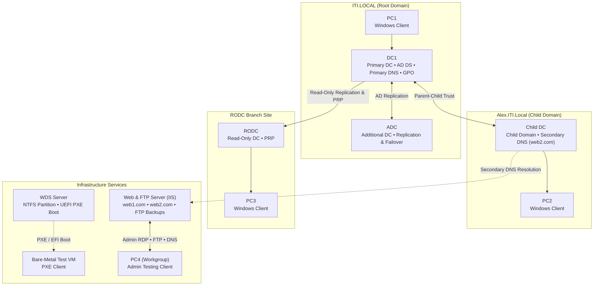

# Enterprise Windows Server Infrastructure — MCSA Capstone

A multi-domain **Windows Server Enterprise Infrastructure** lab built as the **MCSA Final Hands-On Project** for the **Information Technology Institute (ITI) — 9-Month Professional Training Program**.

---

## Table of Contents

- [Project Overview](#project-overview)
- [Network & Domain Architecture](#network--domain-architecture)
- [Infrastructure Inventory](#infrastructure-inventory)
- [Policies & User Access Matrix](#policies--user-access-matrix)
- [Automated OS Deployment (WDS)](#automated-os-deployment-wds)
- [Verification & Lab Evidence](#verification--lab-evidence)
- [Team](#team)

---

## Project Overview

This capstone project simulates a production-grade, multi-site enterprise environment composed of **10 Virtual Machines (6 Servers, 4 Clients)** across **2 Active Directory Domains**, distributed over **5 physical host laptops**.

### The Real-World Networking Challenge
Rather than isolating all VMs inside a single host-only virtual switch, the entire lab was networked across **5 separate physical laptops**:
- **Physical Interconnect:** Linked via a shared mobile hotspot.
- **Virtual Networking:** Configured with **VMware Bridged Networking** so all VMs communicate across physical hosts as direct network peers.
- **IP Addressing:** Managed with **Static IPs** (`10.x.x.x` subnet) to guarantee deterministic DNS resolution, AD replication, and service routing.

---

## Network & Domain Architecture

> **Note:** If you upload your topology diagram image to the repository (e.g., `docs/architecture.png`), you can display it here using ``.

---

## Infrastructure Inventory

| Role / Hostname | Type | Domain / Workgroup | Core Responsibilities |
| :--- | :--- | :--- | :--- |
| **DC1** | Server | `ITI.LOCAL` | Primary Domain Controller, AD DS, Primary DNS, GPO Management |
| **ADC** | Server | `ITI.LOCAL` | Additional Domain Controller for AD replication and failover |
| **Child DC** | Server | `Alex.ITI.Local` | Child Domain Controller, Parent-Child Trust, Local Secondary DNS Zone (`web2.com`) |
| **RODC** | Server | `ITI.LOCAL` | Read-Only Domain Controller for branch security & Password Replication Policy (PRP) |
| **Web & FTP Server** | Server | Workgroup | IIS hosting (`www.web1.com`, `www.web2.com`), FTP backup service, Authoritative DNS |
| **WDS Server** | Server | `ITI.LOCAL` | Automated OS deployment via UEFI PXE boot, Boot/Install WIM images |
| **PC1** | Client | `ITI.LOCAL` | Root domain GPO testing and cross-domain login validation |
| **PC2** | Client | `Alex.ITI.Local` | Child domain workstation |
| **PC3** | Client | `ITI.LOCAL` | Branch client authenticating via RODC cached credentials |
| **PC4** | Client | Workgroup | Local admin workstation for Web Server RDP, FTP backup retrieval, and DNS checks |

---

## Policies & User Access Matrix

### 1. Root Domain (`ITI.LOCAL`) — Tested on `PC1`
| Account | Policy / Capability | Implementation |
| :--- | :--- | :--- |
| `USR1@ITI.LOCAL` | Blocked from logging into `PC1` on Fridays | AD Account Logon Hours |
| `user2@ITI.LOCAL` | Logs into `PC1` and RDPs into `DC1` without Domain Admin rights | Delegated RDP & GPO |
| `user3@ITI.LOCAL` | WinRAR installed automatically on `PC1` | Software Installation GPO (`winrar`) |
| `user3` & `user4@ITI.LOCAL` | USB flash drives blocked, Control Panel restricted, ITI logo forced as wallpaper | User Configuration GPOs (`FCPDW`, `wallpaper`) |
| **Roaming User** | Profile and files follow the user across domain machines | Roaming User Profiles (`romming`) |

### 2. Child Domain (`Alex.ITI.Local`)
| Account | Policy / Capability | Implementation |
| :--- | :--- | :--- |
| `user6@alex.iti.local` | Authenticates to `PC1` (Smart Village / Root site) and browses `http://www.web2.com` | Parent-Child Trust & Alex Local Secondary DNS Zone |

### 3. Branch Security (`RODC` — `PC3`)
| Account | Policy / Capability | Implementation |
| :--- | :--- | :--- |
| `user8` | Logs in **only** to the RODC; cannot create users, but delegated permission to shut down the RODC | RODC Role Separation & Delegation |
| `user9` | Logs into `PC3` with credentials cached on the RODC | Password Replication Policy (PRP) |

### 4. Web Hosting, DNS & FTP (`PC4` — Workgroup)
| Account | Policy / Capability | Implementation |
| :--- | :--- | :--- |
| `user7` (Local on `PC4`) | Admin RDP access to the Web Server, pulls Web Server backups to `PC4` via FTP (FileZilla), and authoritatively resolves `http://www.web1.com` | IIS, FTP Service, Primary DNS (`nslookup` verified) |

---

## Automated OS Deployment (WDS)

Windows Deployment Services (WDS) was configured and validated end-to-end on a fresh bare-metal test VM:

1. **Storage:** Configured a dedicated **NTFS partition** for the `RemoteInstall` folder.
2. **Images:** Imported **Boot and Install WIM images** (Windows Server 2022).
3. **PXE Configuration:** Enabled **UEFI PXE network boot** with PXE responses allowed for both known and unknown clients.
4. **Validation:** Successfully booted a clean test VM over the network directly into the Windows Server 2022 Setup wizard.

---

## Verification & Lab Evidence

Key milestones verified and documented in the project presentation and screenshots:
- **Active Directory Users & Computers:** OU structure for `iti.local` (`usr1`–`usr10`) and `alex.iti.local` (`OU1` / `User6`).
- **Group Policy Management:** Linked GPOs (`winrar`, `wallpaper`, `RDP`, `romming`, `FCPDW`, `chrome`).
- **DNS Management:** `web2.com` Secondary Forward Lookup Zone on `Alex.ITI.Local` and `nslookup` verification from `PC4`.
- **IIS, FTP & RDP:** FileZilla backup transfers to `C:\backup\` on `PC4` and administrative RDP session into the Web Server.
- **WDS PXE Boot:** Live UEFI network boot into Windows Deployment Services Setup.

---

## Team

Built by the **ITI 9-Month Professional Training Program** team:

- **Abdelfatah Mohammed**
- **Kholod Tawfeek**
- **Menna Kassem**
- **Tariq Motawea**
- ****
